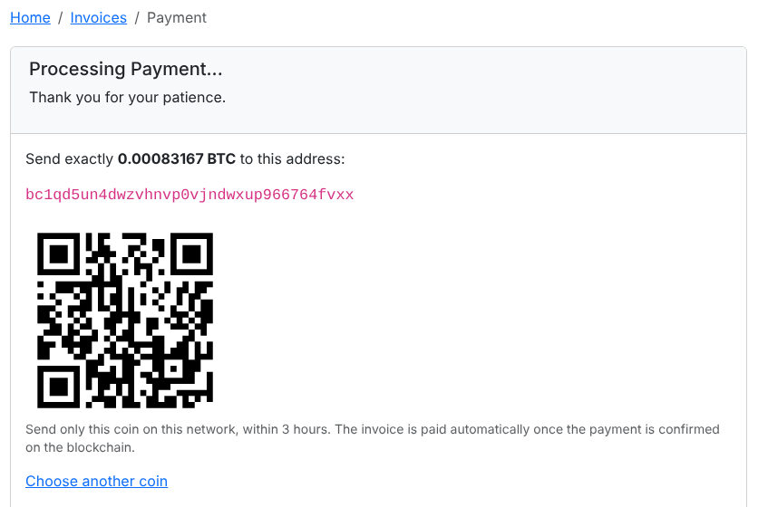
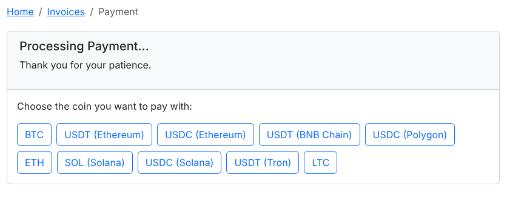

# Crypto Payment Gateway FOSSBilling
Accept Bitcoin, Ethereum, USDT, USDC, Solana, Litecoin, Monero, Zcash and more on your FOSSBilling invoices. Every payment is forwarded instantly to your own wallets. No KYC, no sign up.

> 💳 **Want cards too?** Our free [FOSSBilling card module](https://github.com/paygate-to/FOSSBilling-Instant-Payment-Gateway) accepts Visa, Mastercard, Apple Pay and Google Pay with instant USDC payouts.

## Features

- The only crypto payment gateway with **instant payouts for Solana (SOL), Monero (XMR), Zcash (ZEC) and Bitcoin (BTC)**.
- Two ways for clients to pay:
  - **Hosted multi-coin page** (recommended): the client picks any coin of the networks you accept.
  - **On your invoice page**: the client picks a coin and gets an address and a QR code right in your client area.
- **No sign up, no API keys, no KYC** for you or your clients. Your wallet addresses are all you need.
- Optional: the client pays the blockchain fee.
- Optional: an underpayment tolerance and the number of confirmations.
- **Secure confirmations**:
  - every payment confirmation is signed by PayGate.to and checked against the bundled public key;
  - every callback URL is signed with your installation's secret;
  - repeated confirmations are ignored;
  - the payout must go to your wallets, and the coin and the amount are checked before an invoice is paid.
- Works with your own checkout domain and a free dedicated API endpoint ([custom domain guide](https://paygate.to/white-label-api-custom-domain-guide/)).
- Fees: **1.5% + blockchain fees**.

📘 **Step-by-step guide:** [https://paygate.to/crypto-payment-gateway-no-kyc-instant-payouts/fossbilling/](https://paygate.to/crypto-payment-gateway-no-kyc-instant-payouts/fossbilling/)



## Requirements

- **FOSSBilling 0.7.2 or newer.** Tested on 0.7.2 and 0.8.8.
- PHP with the OpenSSL extension, which FOSSBilling already requires.
- Access to your server files (FTP/SFTP or your hosting File Manager).
- FOSSBilling must be reachable at its public **https** address, because payment confirmations are sent to `https://your-site/ipn.php`.
- A self-custodial wallet address for each network you want to accept.

## Installation

1. **Prepare your wallets**, one per network:
   - **EVM**: one `0x` address for ETH, USDT and USDC on Ethereum, BNB Chain, Polygon, Arbitrum, Base, Optimism and Avalanche.
   - **Bitcoin, Litecoin, Bitcoin Cash, Dogecoin, Solana, Tron (TRX and USDT TRC20)**.
   - **Monero, Zcash and TON** (hosted page).

   Use wallets only you control: Trust Wallet, Exodus, Phantom, Cake Wallet, or a hardware wallet. **Never use exchange deposit addresses.**
2. **Download** [FOSSBilling-Crypto-Payment-Gateway-main.zip](https://github.com/paygate-to/FOSSBilling-Crypto-Payment-Gateway/archive/refs/heads/main.zip) and unzip it.
3. **Upload the `PayGateCrypto` folder** into `library/Payment/Adapter/` of your FOSSBilling installation:

   ```
   FOSSBilling-Crypto-Payment-Gateway-main/      <fossbilling>/library/Payment/Adapter/
   └── PayGateCrypto/        ── upload ──►       └── PayGateCrypto/
                                                     ├── PayGateCrypto.php
                                                     ├── logo.png
                                                     └── keys/paygate_callback_public_v1.pem
   ```

4. **Install it.** Go to **System › Payment gateways**, click **New payment gateway**, then click the install button next to **PayGateCrypto**.
5. **Configure it.** Click the new gateway in the list and fill in:

   | Field | What to enter |
   |---|---|
   | Payment Gateway Title | The name clients see, e.g. "Crypto (Bitcoin, USDT, Solana…)" |
   | Checkout | **Hosted multi-coin page** (recommended) or **Address and QR code on the invoice page** |
   | Network wallets | Your wallet for each network you accept. Leave a network empty to not accept it. |
   | Coins on the invoice page | Optional, for the invoice page: coin ids such as `btc, erc20_usdt, trc20_usdt, sol_sol` ([all coin ids](https://api.paygate.to/crypto/info.php)). Leave empty for the common coins of the networks you filled in. |
   | Network fee | Who pays the estimated blockchain fee: you (default) or the client |
   | Underpayment tolerance | Payments within this margin pay the invoice. Default 2%. |
   | Confirmations (invoice page) | Blockchain confirmations before the invoice is paid. Default 1. |
   | Dedicated API endpoint | Optional: your free endpoint, e.g. `api-yourshop-1a2b3c.paygate.to` |
   | Checkout domain, colour, logo URL | Optional white-label settings for the hosted page |

   Then switch on **Enabled** and **Allow One Time Payments**, and click **Update Gateway** (**Update** on FOSSBilling 0.7).
6. **Test with an invoice.** The client chooses the crypto payment method and then either:
   - picks a coin on the hosted page, or
   - picks a coin on your invoice page and sends the exact amount shown.

   When the payment is confirmed on the blockchain, the crypto is forwarded to your wallet and the invoice is marked **Paid**.



## Where to see payments

Each payment confirmation becomes a transaction under **Invoices › Transactions**.

| Transaction | Meaning |
|---|---|
| Processed, status *Paid* | The invoice was paid. The note shows the amount received and the blockchain transaction ids. |
| Code **3001** (underpaid) | Less than the amount due arrived, beyond your tolerance. The invoice stays unpaid and the funds are already in your wallet: settle the difference with the client. |
| Code **3002** (wrong coin) | A different coin or token was sent to the address. It was forwarded to you; check it before releasing the order. |
| Code **3003** (extra payment) | The invoice was already paid (for example the client paid twice) or was cancelled. The funds are in your wallet: refund the client or add the amount to their balance. |
| Code **3004** (wrong payout) | The payout did not go to the wallets configured in the module, so the invoice was not paid. Contact support if you see this. |
| Status *Duplicate* | PayGate.to sent the same confirmation again. Nothing more was credited. |
| Status *Error*, message *PayGate.to callback rejected* | Not a genuine PayGate.to confirmation, or one that was changed. Nothing was paid. |

Prices:
- On the invoice page, the amount quoted to the client is checked. A quote is valid for 3 hours; if the payment arrives later, or the invoice total was changed after the quote, the invoice is priced again at the current rate.
- On the hosted page, the invoice is priced in the coin the client chose when the confirmation arrives.

**Add funds** invoices need at least 98% of the amount, whatever your tolerance, because the full amount is added to the client's balance.

Each coin has a minimum ([see the minimums](https://paygate.to/crypto-payment-gateway-no-kyc-instant-payouts/#minimumorder)). Below it, the client is asked to choose another coin.

## Updating

Upload the `PayGateCrypto` folder again, overwriting the old files. Your settings are kept.

## Troubleshooting

- **PayGateCrypto is not in the New payment gateway list.** Check that the file is at `library/Payment/Adapter/PayGateCrypto/PayGateCrypto.php`.
- **"Not fully configured".** Fill in the wallet of at least one network.
- **The client paid but the invoice is still unpaid.**
  - Open **Invoices › Transactions**.
  - If there is no transaction, `https://your-site/ipn.php` is not reachable from the internet (maintenance mode, password protection, IP allow-lists).
  - Otherwise the code tells you why; see the table above.
- **A coin is missing on the invoice page.** Its network has no wallet, or it is not in your coin list.

Full product page: [https://paygate.to/crypto-payment-gateway-no-kyc-instant-payouts/](https://paygate.to/crypto-payment-gateway-no-kyc-instant-payouts/) · Support: [Telegram](https://t.me/PayGate_to)
